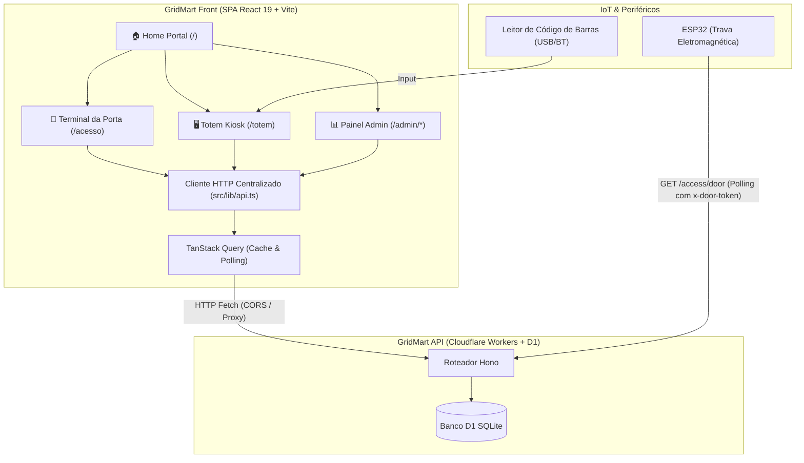

# 🛒 GridMart Front

> **Frontend Web Integrado para Mercados Autônomos (Honest Market / Micromarket)**  
> Abrangendo **Totem de Autoatendimento (Kiosk)**, **Terminal de Acesso à Porta** e **Painel Administrativo Completo de Gestão**.

O **GridMart Front** é a interface web do ecossistema GridMart. Ele se comunica de ponta a ponta com a [GridMart API](file:///c:/Users/Usuario/gridmart-api) (Cloudflare Workers + D1) e com a trava eletromagnética controlada via microcontrolador ESP32.

---

## 📑 Índice

- [🆕 Novidades Recentes da Implementação](#-novidades-recentes-da-implementação)
- [💡 Visão Geral dos Módulos](#-visão-geral-dos-módulos)
- [🏛️ Arquitetura Integrada do Sistema](#️-arquitetura-integrada-do-sistema)
- [🛠️ Stack Tecnológica](#️-stack-tecnológica)
- [📦 Estrutura de Rotas e Páginas](#-estrutura-de-rotas-e-páginas)
  - [1. Totem de Autoatendimento (`/totem`)](#1-totem-de-autoatendimento-totem)
  - [2. Terminal de Controle de Acesso (`/acesso`)](#2-terminal-de-controle-de-acesso-acesso)
  - [3. Painel Administrativo de Gestão (`/admin`)](#3-painel-administrativo-de-gestão-admin)
- [📁 Estrutura de Diretórios](#-estrutura-de-diretórios)
- [⚙️ Guia de Configuração e Execução Local](#️-guia-de-configuração-e-execução-local)
- [🚀 Build e Deploy em Produção](#-build-e-deploy-em-produção)
- [📄 Documentação Relacionada](#-documentação-relacionada)

---

## 🆕 Novidades Recentes da Implementação

> Consulte o arquivo [`IMPLEMENTACOES-RECENTES.md`](file:///C:/Users/Usuario/gridmart-front/IMPLEMENTACOES-RECENTES.md) para o relatório detalhado de commits e melhorias das últimas 48 horas.

- **Assistente de Cadastro de Produtos em 4 Passos**:
  - Wizard guiado passo a passo (Código de Barras ➔ Classificação por Departamento/Categoria ➔ Marca e Embalagem ➔ Variação, Conteúdo Líquido e Preço).
  - Geração automática padronizada do nome comercial (`buildProductName`) com pré-visualização dinâmica em tempo real (ex.: *"Refrigerante Coca-Cola Zero Lata 350 ml"*).
  - Criação rápida de novas marcas diretamente no modal de cadastro.
- **Módulo de Grupos de Preço (`/admin/precos`)**:
  - Criação e governança de políticas de preços unificadas (ex.: "Bebidas R$ 6,00", "Snacks R$ 4,50").
  - Interface interativa para vinculação e sincronização em lote de múltiplos produtos via checkbox.
- **Módulo de Categorias & Departamentos (`/admin/categorias`)**:
  - Organização visual do catálogo por departamentos com controle de tipos, edição e exclusão protegida.
- **Aplicação da Identidade Visual Oficial (Branding)**:
  - Componente centralizado [`BrandLogo`](file:///C:/Users/Usuario/gridmart-front/src/components/brand-logo.tsx) com versões otimizadas (`logo-256.png`, `logo-512.png`) e favicon oficial integrado.
- **Modernização de Stack**:
  - Atualização completa para **React 19**, **Tailwind CSS v4**, **shadcn/ui** (Radix UI), **TanStack Query v5** e linter de alta performance com **Oxlint**.

---

## 💡 Visão Geral dos Módulos

```
┌─────────────────┐       ┌─────────────────┐       ┌─────────────────┐
│  Porta / Acesso │       │  Totem / Kiosk  │       │  Painel Admin   │
│   (/acesso)     │       │    (/totem)     │       │    (/admin)     │
└────────┬────────┘       └────────┬────────┘       └────────┬────────┘
         │                         │                         │
         └─────────────────────────┼─────────────────────────┘
                                   ▼
                 [ GridMart API (Cloudflare Workers) ]
                                   ▲
                                   │ polling (500ms)
                     [ Hardware Trava IoT (ESP32) ]
```

1. **Terminal da Porta (`/acesso`)**: Interface mobile/tablet posicionada na entrada e saída física da loja. Valida CPF para liberação de destravamento e consome tokens de saída instantaneamente.
2. **Totem de Autoatendimento (`/totem`)**: Kiosk de compras com suporte a leitor de código de barras, carrinho em tempo real, geração de QR Code Pix (Mercado Pago), polling de confirmação e geração de QR Code temporizado de saída (25s).
3. **Painel de Gestão (`/admin`)**: Retaguarda administrativa protegida por token com controle de catálogo, categorias, grupos de preço, monitor de vendas, visitas em loja, gestão de usuários e auditoria da trava.

---

## 🏛️ Arquitetura Integrada do Sistema



---

## 🛠️ Stack Tecnológica

| Tecnologia | Versão | Finalidade |
| :--- | :--- | :--- |
| **[React](https://react.dev/)** | `19.3.1` | Biblioteca central de renderização de componentes de interface |
| **[TypeScript](https://www.typescriptlang.org/)** | `~6.0.3` | Tipagem estática rigorosa compartilhada com os contratos da API |
| **[Vite](https://vite.dev/)** | `^8.3.4` | Build tool ultrarrápido, HMR instantâneo e servidor de desenvolvimento |
| **[Tailwind CSS](https://tailwindcss.com/)** | `^4.3.3` | Framework de utilitários CSS moderno e de alta performance |
| **[shadcn/ui](https://ui.shadcn.com/) / [Radix UI](https://www.radix-ui.com/)** | `4.22.1` | Componentes primitivos acessíveis (diálogos, dropdowns, badges, tabelas) |
| **[TanStack Query](https://tanstack.com/query)** | `^5.104.5` | Gerenciamento de estado de servidor, cache, refetching e polling |
| **[React Router](https://reactrouter.com/)** | `^8.5.0` | Roteamento declarativo do SPA |
| **[qrcode.react](https://github.com/zpao/qrcode.react)** | `^4.2.0` | Renderização nativa em canvas/SVG do Pix e do token de saída |
| **[Sonner](https://sonner.emilkowal.ski/)** | `^2.0.8` | Sistema de notificações toast para feedback de ações |
| **[Oxlint](https://oxc-project.github.io/)** | `^1.88.0` | Linter em Rust ultrarrápido para garantia de código limpo |
| **[Bun](https://bun.sh/)** | `Latest` | Gerenciador de pacotes e runtime local recomendado |

---

## 📦 Estrutura de Rotas e Páginas

### 1. Totem de Autoatendimento (`/totem`)
- **Passo 1: Identificação do Cliente**: Validação de CPF via algoritmo oficial da Receita Federal (módulo 11). Se for novo cliente, apresenta formulário simplificado de cadastro.
- **Passo 2: Carrinho & Leitura de Código de Barras**: Foco contínuo para leitores USB/Bluetooth ou digitação manual; ajuste dinâmico de quantidades e resumo financeiro.
- **Passo 3: Pagamento Pix**: Criação da venda com status `PENDING`, renderização do payload Pix em QR Code e código Copia e Cola. Polling automático até detecção do status `PAID` (com fallback manual para o operador).
- **Passo 4: Liberação de Saída**: Exibição do QR Code temporizado de saída (validade de 25 segundos). O cliente aponta o celular para este QR para abrir a porta automaticamente.

### 2. Terminal de Controle de Acesso (`/acesso`)
- **Modo Entrada**: Leitor rápido de CPF com auto-submit ao completar os 11 dígitos. Verifica se o usuário possui cadastro ativo e destrava a trava eletromagnética.
- **Modo Saída Inteligente**: O botão de saída só é disponibilizado para clientes que possuem visita em aberto.
- **Consumo Automático por URL**: Ao acessar a rota com parâmetro de query (ex: `/acesso?token=...`), o sistema consome o token e libera a porta instantaneamente sem interação manual.

### 3. Painel Administrativo de Gestão (`/admin`)
Protegido por autenticação de token armazenado em `localStorage` (`x-admin-token`):

- **`/admin/produtos`**: Gestão do catálogo com tabela interativa, filtros sem acento (`normalizeText`), status Ativo/Inativo e o **Wizard de 4 passos** com construtor inteligente de nomes.
- **`/admin/categorias`**: Árvore estruturada de departamentos (Bebidas, Mercearia, etc.) e tipos com criação e edição em modal.
- **`/admin/precos`**: Definição de grupos de preço com sincronização em lote de múltiplos itens.
- **`/admin/vendas`**: Linha do tempo das vendas, exibição de QR Pix e baixa manual em caso de contingência.
- **`/admin/visitas`**: Monitor em tempo real dos clientes atualmente dentro do estabelecimento físico, com opção de encerramento forçado de visita.
- **`/admin/usuarios`**: Relação de clientes cadastrados, com bloqueio/desbloqueio imediato para impedir acesso na fechadura.
- **`/admin/auditoria`**: Log detalhado de todos os eventos da porta física (`ENTRY` / `EXIT`, `GRANTED` / `DENIED`).

---

## 📁 Estrutura de Diretórios

```
gridmart-front/
├── public/
│   ├── brand/                          # Logos oficiais otimizadas (256px, 512px, horizontal)
│   ├── _redirects                      # Regra de roteamento SPA para Cloudflare Pages
│   ├── favicon.svg                     # Ícone do navegador
│   └── icons.svg                       # Sprites SVG do sistema
├── src/
│   ├── components/
│   │   ├── ui/                         # Primitivos shadcn/ui (button, dialog, table, input...)
│   │   ├── brand-logo.tsx              # Componente oficial de logotipo e tipografia
│   │   ├── cpf-input.tsx               # Campo de CPF com máscara automática 000.000.000-00
│   │   └── status-badge.tsx            # Badges visuais (PAID, PENDING, GRANTED, DENIED...)
│   ├── features/
│   │   ├── access/                     # Tela do terminal de porta (AccessPage.tsx)
│   │   ├── admin/                      # 7 telas do painel administrativo
│   │   │   ├── AdminCategoriesPage.tsx # Gestão de Departamentos e Categorias
│   │   │   ├── AdminPriceGroupsPage.tsx# Gestão de Grupos de Preço e seleção em massa
│   │   │   ├── AdminProductsPage.tsx   # Catálogo e Wizard de 4 passos
│   │   │   ├── AdminSalesPage.tsx      # Monitoramento de Vendas
│   │   │   ├── AdminVisitsPage.tsx     # Controle de Visitas ativas
│   │   │   ├── AdminUsersPage.tsx      # Gestão de Clientes e Bloqueios
│   │   │   ├── AdminLogsPage.tsx       # Auditoria de Acesso da porta
│   │   │   └── AdminLayout.tsx         # Sidebar de navegação e autenticação
│   │   ├── home/                       # Portal inicial de navegação (HomePage.tsx)
│   │   └── totem/                      # Máquina de estados do Totem de Checkout
│   │       ├── ShopStep.tsx            # Escaneamento e carrinho
│   │       ├── PaymentStep.tsx         # Cobrança e confirmação Pix
│   │       ├── ExitStep.tsx            # Emissão do QR Code de saída (25s)
│   │       └── TotemPage.tsx           # Orquestrador do fluxo
│   ├── lib/
│   │   ├── api.ts                      # Cliente HTTP com tipagem e injeção de x-admin-token
│   │   ├── cpf.ts                      # Validador oficial módulo 11
│   │   ├── format.ts                   # Formatadores de moeda (BRL), data e contadores
│   │   ├── product-name.ts             # Construtor padronizado de nomes de produtos
│   │   ├── types.ts                    # Contratos de dados espelhados da API
│   │   └── utils.ts                    # Utilitário tailwind clsx/twMerge (cn)
│   ├── App.tsx                         # Definição de rotas e provedores React
│   ├── index.css                       # Variáveis de tema CSS e Tailwind v4
│   └── main.tsx                        # Bootstrap da aplicação
├── IMPLEMENTACOES-RECENTES.md          # Log das novidades implementadas nos últimos 2 dias
├── package.json                        # Dependências e scripts
└── vite.config.ts                      # Configuração do Vite e plugins
```

---

## ⚙️ Guia de Configuração e Execução Local

### Pré-requisitos
- [Bun](https://bun.sh/) (recomendado) ou [Node.js](https://nodejs.org/) (v18+)
- Backend [`gridmart-api`](file:///c:/Users/Usuario/gridmart-api) executando localmente na porta `8787`

### 1. Instalação das Dependências

```bash
cd C:\Users\Usuario\gridmart-front
bun install
```

### 2. Configuração de Ambiente (`.env`)

Crie ou ajuste o arquivo `.env.local` na raiz:

```env
# URL base da GridMart API (Edge Worker)
VITE_API_URL=http://localhost:8787
```

### 3. Executando em Modo Desenvolvimento

```bash
bun run dev
```

A aplicação estará acessível em: **`http://localhost:5173`**

> [!TIP]
> **Testando com Celular na Mesma Rede Local:**  
> Para escanear o QR Code de saída pelo smartphone, inicie o Vite com `--host`:
> ```bash
> bun run dev --host
> ```
> Em seguida, acesse pelo celular usando o IP local da sua máquina (ex: `http://192.168.1.50:5173`).

### 4. Acesso ao Painel Administrativo

Ao acessar `/admin`, o sistema solicitará o token de acesso (`x-admin-token`). Em ambiente local de desenvolvimento, utilize o valor configurado no `.dev.vars` da API:
```text
dev-admin-token
```

---

## 🚀 Build e Deploy em Produção

O projeto é otimizado para deploy serverless como SPA na **Cloudflare Pages**:

```bash
# 1. Configurar URL de produção
echo "VITE_API_URL=https://sua-api.workers.dev" > .env.production

# 2. Executar verificação de tipos e compilação
bun run build

# 3. Publicar na Cloudflare Pages
bunx wrangler pages deploy dist --project-name gridmart
```

- O arquivo `public/_redirects` garante que rotas como `/totem`, `/acesso` e `/admin/*` funcionem corretamente em recarregamentos (evitando erros 404).

---

## 📄 Documentação Relacionada

- 📑 [`IMPLEMENTACOES-RECENTES.md`](file:///C:/Users/Usuario/gridmart-front/IMPLEMENTACOES-RECENTES.md) — Relatório detalhado das novidades dos últimos 2 dias.
- ⚙️ [README da API (`gridmart-api`)](file:///c:/Users/Usuario/gridmart-api/README.md) — Documentação dos endpoints, schema SQLite/D1 e integração ESP32.
- 💳 [Guia de Configuração Pix em Produção](file:///c:/Users/Usuario/gridmart-api/docs/PIX-PRODUCAO.md) — Configuração das credenciais do Mercado Pago e webhooks.
